RENCHAO WU / WIDECHAOS

<picture><source media="(prefers-reduced-motion: reduce) and (prefers-color-scheme: dark) and (max-width:520px)" srcset="assets/typography/header-dark-mobile-still-3c0de5c022f7.svg"><source media="(prefers-reduced-motion: reduce) and (max-width:520px)" srcset="assets/typography/header-light-mobile-still-0ca4cdbd358d.svg"><source media="(prefers-reduced-motion: reduce) and (prefers-color-scheme: dark)" srcset="assets/typography/header-dark-wide-still-87023feda56a.svg"><source media="(prefers-reduced-motion: reduce)" srcset="assets/typography/header-light-wide-still-93cd0ddac53c.svg"><source media="(prefers-color-scheme: dark) and (max-width:520px)" srcset="assets/typography/header-dark-mobile-cec69eff50f8.svg"><source media="(prefers-color-scheme: dark)" srcset="assets/typography/header-dark-wide-1ee87c237438.svg"><source media="(max-width:520px)" srcset="assets/typography/header-light-mobile-6cb07de0a4eb.svg"></picture>

  <b>智灯已灭余空烬，犹自光明照十方</b> 
  <i>"From the ashes a fire shall be woken, a light from the shadows shall spring." — J.R.R. Tolkien</i>

<h2><picture><source media="(prefers-color-scheme: dark) and (max-width:520px)" srcset="assets/typography/section-1-dark-mobile-c7d0b723fa33.svg"><source media="(prefers-color-scheme: dark)" srcset="assets/typography/section-1-dark-wide-565cb2b06350.svg"><source media="(max-width:520px)" srcset="assets/typography/section-1-mobile-f95eb42a49e0.svg"></picture></h2>

<picture><source media="(prefers-reduced-motion: reduce) and (prefers-color-scheme: dark) and (max-width:520px)" srcset="assets/typography/identity-panel-dark-mobile-still-e328ae10ad4b.svg"><source media="(prefers-reduced-motion: reduce) and (max-width:520px)" srcset="assets/typography/identity-panel-light-mobile-still-24ee7f82afb9.svg"><source media="(prefers-reduced-motion: reduce) and (prefers-color-scheme: dark)" srcset="assets/typography/identity-panel-dark-wide-still-02999894ee1e.svg"><source media="(prefers-reduced-motion: reduce)" srcset="assets/typography/identity-panel-light-wide-still-2c102482bce0.svg"><source media="(prefers-color-scheme: dark) and (max-width:520px)" srcset="assets/typography/identity-panel-dark-mobile-a2d6b45846ed.svg"><source media="(prefers-color-scheme: dark)" srcset="assets/typography/identity-panel-dark-wide-9305176af0a7.svg"><source media="(max-width:520px)" srcset="assets/typography/identity-panel-light-mobile-19479d98c021.svg"></picture>

NOW / Voice agents & realtime systems

<b>./manifesto</b>

<picture><source media="(prefers-color-scheme: dark) and (max-width:520px)" srcset="assets/manifesto-dark-mobile.svg"><source media="(prefers-color-scheme: dark)" srcset="assets/manifesto-dark.svg"><source media="(max-width:520px)" srcset="assets/manifesto-light-mobile.svg"></picture>

<h2><picture><source media="(prefers-color-scheme: dark) and (max-width:520px)" srcset="assets/typography/section-2-dark-mobile-ca81b69b2575.svg"><source media="(prefers-color-scheme: dark)" srcset="assets/typography/section-2-dark-wide-3d29f3723cd9.svg"><source media="(max-width:520px)" srcset="assets/typography/section-2-mobile-4d4e46112417.svg"></picture></h2>

Repository languages

<h2><picture><source media="(prefers-color-scheme: dark) and (max-width:520px)" srcset="assets/typography/section-3-dark-mobile-9a2273884b4f.svg"><source media="(prefers-color-scheme: dark)" srcset="assets/typography/section-3-dark-wide-cd76391a391e.svg"><source media="(max-width:520px)" srcset="assets/typography/section-3-mobile-b13d9fd593ef.svg"></picture></h2>

<!-- COMMUNITY-BADGES:START -->

<a href="assets/certificates/databricks-generative-ai.png"><picture><source media="(prefers-color-scheme: dark)" srcset="assets/collection/29f1581c5758ec6864f1-dark.svg"></picture></a> <a href="assets/certificates/databricks-ai-agent.png"><picture><source media="(prefers-color-scheme: dark)" srcset="assets/collection/941fb8c4f35937df063f-dark.svg"></picture></a> <a href="assets/certificates/databricks-ai-security.png"><picture><source media="(prefers-color-scheme: dark)" srcset="assets/collection/7ae062d0e10238b65687-dark.svg"></picture></a> <a href="assets/certificates/huggingface-agents-unit1.png"><picture><source media="(prefers-color-scheme: dark)" srcset="assets/collection/fcce51a17a26424c61eb-dark.svg"></picture></a> <a href="assets/certificates/huggingface-agents-course.png"><picture><source media="(prefers-color-scheme: dark)" srcset="assets/collection/19c2fc201a209771fe73-dark.svg"></picture></a> <a href="assets/certificates/alibaba-cloud-generative-ai.png"><picture><source media="(prefers-color-scheme: dark)" srcset="assets/collection/2f2a114038a1e08188fd-dark.svg"></picture></a> <a href="assets/certificates/cognitive-class-prompt-engineering.png"><picture><source media="(prefers-color-scheme: dark)" srcset="assets/collection/e90ec5fb86acbd612639-dark.svg"></picture></a> <a href="assets/certificates/cognitive-class-chatbot.png"><picture><source media="(prefers-color-scheme: dark)" srcset="assets/collection/675a6532b03012945927-dark.svg"></picture></a> <a href="assets/certificates/cognitive-class-fundamentals-ai.png"><picture><source media="(prefers-color-scheme: dark)" srcset="assets/collection/9cdd8377d08371b31a6d-dark.svg"></picture></a> <a href="assets/certificates/cognitive-class-machine-learning.png"><picture><source media="(prefers-color-scheme: dark)" srcset="assets/collection/062b8590be830862da00-dark.svg"></picture></a> <a href="assets/certificates/ibm-skillsbuild-ai-fundamentals.png"><picture><source media="(prefers-color-scheme: dark)" srcset="assets/collection/e8e1e922ca9ac3d8e34f-dark.svg"></picture></a>

Verify learning credentials

- [Databricks Academy · Generative AI Fundamentals](https://credentials.databricks.com/df0c7dc3-88d9-4de0-99d4-781e917aae76)
- [Databricks Academy · AI Agent Fundamentals](https://credentials.databricks.com/d56e8b1d-3c06-43cb-8b4f-6f4d6778a9fc)
- [Databricks Academy · AI Security Fundamentals](https://credentials.databricks.com/7c66e79f-43fd-4b94-8f2a-12a2c8f16739)
- [Hugging Face · Fundamentals of Agents · Unit 1 certificate](https://huggingface.co/datasets/agents-course/certificates/resolve/main/certificates/WideChaos/2026-10-03.png)
- [Hugging Face · Agents Course certificate](https://huggingface.co/datasets/agents-course/final-certificates/resolve/main/certificates/WideChaos/2026-10-03.png)
- [Alibaba Cloud · Apsara Clouder · Generative AI](https://github.com/widechaos/widechaos/blob/main/assets/certificates/alibaba-cloud-generative-ai.png)
- [Cognitive Class · Prompt Engineering for Everyone certificate](https://courses.cognitiveclass.ai/certificates/c1d112d619974cdcb875f699f5ac5160)
- [Cognitive Class · Build Your Own Chatbot certificate](https://courses.cognitiveclass.ai/certificates/e8e77941abd24f7abaa34b7cc73f20e8)
- [Cognitive Class · Fundamentals of AI certificate](https://cognitiveclass.ai/certificates/0254c79f-80f4-4ebb-afd1-71ae598bd586)
- [Cognitive Class · Machine Learning with Python certificate](https://courses.cognitiveclass.ai/certificates/807e7b774e0c4761a182d824ac569b55)
- [IBM SkillsBuild · Artificial Intelligence Fundamentals certificate](https://www.credly.com/badges/3a952e96-b388-4424-8e54-33d3f631fe6c/public_url)

<a href="https://www.kaggle.com/certification/badges/xover2022/107"><picture><source media="(prefers-color-scheme: dark)" srcset="assets/collection/33e35f2aae7c3eee81f4-dark.svg"></picture></a> <a href="https://www.kaggle.com/certification/badges/xover2022/30"><picture><source media="(prefers-color-scheme: dark)" srcset="assets/collection/6991af5f83f5860308bf-dark.svg"></picture></a> <a href="https://www.kaggle.com/certification/badges/xover2022/37"><picture><source media="(prefers-color-scheme: dark)" srcset="assets/collection/4ec814e4245f4c0f3ace-dark.svg"></picture></a> <a href="https://www.kaggle.com/certification/badges/xover2022/50"><picture><source media="(prefers-color-scheme: dark)" srcset="assets/collection/c27ea82c99238d507f54-dark.svg"></picture></a> <a href="https://www.kaggle.com/xover2022"><picture><source media="(prefers-color-scheme: dark)" srcset="assets/collection/2135e11d761578599cba-dark.svg"></picture></a> <a href="https://www.kaggle.com/xover2022"><picture><source media="(prefers-color-scheme: dark)" srcset="assets/collection/38f3e7ff5abd1f49f263-dark.svg"></picture></a> <a href="https://www.kaggle.com/xover2022"><picture><source media="(prefers-color-scheme: dark)" srcset="assets/collection/2ee97e4d00a3d5cbe073-dark.svg"></picture></a> <a href="https://www.kaggle.com/xover2022"><picture><source media="(prefers-color-scheme: dark)" srcset="assets/collection/547500d5dfbcc8e43589-dark.svg"></picture></a> <a href="https://www.kaggle.com/xover2022"><picture><source media="(prefers-color-scheme: dark)" srcset="assets/collection/0fe0868a7e0ca9aa3cf6-dark.svg"></picture></a> <a href="https://www.kaggle.com/xover2022"><picture><source media="(prefers-color-scheme: dark)" srcset="assets/collection/70cbb28e82f689a4d39a-dark.svg"></picture></a> <a href="https://www.kaggle.com/xover2022"><picture><source media="(prefers-color-scheme: dark)" srcset="assets/collection/a658121678fe803f6c2e-dark.svg"></picture></a> <a href="https://www.kaggle.com/xover2022"><picture><source media="(prefers-color-scheme: dark)" srcset="assets/collection/6ffca57dd0cd0514cf7a-dark.svg"></picture></a> <a href="https://dev.to/widechaos"><picture><source media="(prefers-color-scheme: dark)" srcset="assets/collection/c674d22332a1f1ef2dcd-dark.svg"></picture></a> <a href="https://dev.to/widechaos"><picture><source media="(prefers-color-scheme: dark)" srcset="assets/collection/5afd34d4e89f1c41bf63-dark.svg"></picture></a> <a href="https://www.kaggle.com/certification/badges/xover2022/33"><picture><source media="(prefers-color-scheme: dark)" srcset="assets/collection/4f22f096153cd05d4214-dark.svg"></picture></a> <a href="https://www.kaggle.com/certification/badges/xover2022/5"><picture><source media="(prefers-color-scheme: dark)" srcset="assets/collection/1d45ec0973e1f8900b61-dark.svg"></picture></a> <a href="https://www.kaggle.com/certification/badges/xover2022/13"><picture><source media="(prefers-color-scheme: dark)" srcset="assets/collection/b909dd40d6ae1e6a37b9-dark.svg"></picture></a> <a href="https://www.kaggle.com/certification/badges/xover2022/39"><picture><source media="(prefers-color-scheme: dark)" srcset="assets/collection/ed7b9e9df55070cb4f05-dark.svg"></picture></a> <a href="https://www.kaggle.com/certification/badges/xover2022/40"><picture><source media="(prefers-color-scheme: dark)" srcset="assets/collection/e2e2dd97cbf071ae02b0-dark.svg"></picture></a> <a href="https://www.kaggle.com/certification/badges/xover2022/29"><picture><source media="(prefers-color-scheme: dark)" srcset="assets/collection/a92026b48fc840575f72-dark.svg"></picture></a> <a href="https://www.kaggle.com/certification/badges/xover2022/56"><picture><source media="(prefers-color-scheme: dark)" srcset="assets/collection/8f48444d739bb848a952-dark.svg"></picture></a> <a href="https://www.kaggle.com/certification/badges/xover2022/31"><picture><source media="(prefers-color-scheme: dark)" srcset="assets/collection/b5e384d5a637892b82fc-dark.svg"></picture></a> <a href="https://www.kaggle.com/certification/badges/xover2022/32"><picture><source media="(prefers-color-scheme: dark)" srcset="assets/collection/8f1ab30d9d26da25b76a-dark.svg"></picture></a> <a href="https://www.kaggle.com/certification/badges/xover2022/38"><picture><source media="(prefers-color-scheme: dark)" srcset="assets/collection/8eb2f9b6b02f9f24ca54-dark.svg"></picture></a> <a href="https://www.kaggle.com/certification/badges/xover2022/44"><picture><source media="(prefers-color-scheme: dark)" srcset="assets/collection/f1149b9faa131983df54-dark.svg"></picture></a> <a href="https://dev.to/widechaos"><picture><source media="(prefers-color-scheme: dark)" srcset="assets/collection/5c95c4a9ac8ea39de672-dark.svg"></picture></a> 
Kaggle · DEV

<a href="https://weread.qq.com/"><picture><source media="(prefers-color-scheme: dark)" srcset="assets/collection/3e121afbbd99230a6c83-dark.svg"></picture></a> <a href="https://weread.qq.com/"><picture><source media="(prefers-color-scheme: dark)" srcset="assets/collection/6d4fcc84b40a44692882-dark.svg"></picture></a> <a href="https://weread.qq.com/"><picture><source media="(prefers-color-scheme: dark)" srcset="assets/collection/adac10662efcec5f2e92-dark.svg"></picture></a> <a href="https://weread.qq.com/"><picture><source media="(prefers-color-scheme: dark)" srcset="assets/collection/5b6a52caf977413d8155-dark.svg"></picture></a> <a href="https://weread.qq.com/"><picture><source media="(prefers-color-scheme: dark)" srcset="assets/collection/e71e1b13b0fd4c4076d9-dark.svg"></picture></a> <a href="https://weread.qq.com/"><picture><source media="(prefers-color-scheme: dark)" srcset="assets/collection/711b52515364f29ca681-dark.svg"></picture></a> <a href="https://weread.qq.com/"><picture><source media="(prefers-color-scheme: dark)" srcset="assets/collection/8ef0025d5740be6607a6-dark.svg"></picture></a> <a href="https://weread.qq.com/"><picture><source media="(prefers-color-scheme: dark)" srcset="assets/collection/d0b7d0d80d3f7fa20beb-dark.svg"></picture></a> <a href="https://weread.qq.com/"><picture><source media="(prefers-color-scheme: dark)" srcset="assets/collection/700d3f91ad6c095770b4-dark.svg"></picture></a> <a href="https://weread.qq.com/"><picture><source media="(prefers-color-scheme: dark)" srcset="assets/collection/fd18ee0f205fda49a761-dark.svg"></picture></a> <a href="https://weread.qq.com/"><picture><source media="(prefers-color-scheme: dark)" srcset="assets/collection/3395d2a4bf7b07b4499c-dark.svg"></picture></a> <a href="https://weread.qq.com/"><picture><source media="(prefers-color-scheme: dark)" srcset="assets/collection/1e612802cca6b4b9431d-dark.svg"></picture></a> <a href="https://weread.qq.com/"><picture><source media="(prefers-color-scheme: dark)" srcset="assets/collection/c936b99fac96f8b839e0-dark.svg"></picture></a> <a href="https://weread.qq.com/"><picture><source media="(prefers-color-scheme: dark)" srcset="assets/collection/9839eab8fe4f8b7394a9-dark.svg"></picture></a> 
WeRead · Reading milestones

More reading badges

<a href="https://weread.qq.com/"><picture><source media="(prefers-color-scheme: dark)" srcset="assets/collection/533efd7db9eb7cf39eec-dark.svg"></picture></a> <a href="https://weread.qq.com/"><picture><source media="(prefers-color-scheme: dark)" srcset="assets/collection/54fb2001650dc31828f5-dark.svg"></picture></a> <a href="https://weread.qq.com/"><picture><source media="(prefers-color-scheme: dark)" srcset="assets/collection/52e98fbc214774c2ba48-dark.svg"></picture></a> <a href="https://weread.qq.com/"><picture><source media="(prefers-color-scheme: dark)" srcset="assets/collection/5f856d6f21e0e9f8a8a6-dark.svg"></picture></a> <a href="https://weread.qq.com/"><picture><source media="(prefers-color-scheme: dark)" srcset="assets/collection/15039af6404aacefb24d-dark.svg"></picture></a> <a href="https://weread.qq.com/"><picture><source media="(prefers-color-scheme: dark)" srcset="assets/collection/1942c6bbd3222088482d-dark.svg"></picture></a> <a href="https://weread.qq.com/"><picture><source media="(prefers-color-scheme: dark)" srcset="assets/collection/a83daff0211fc270feeb-dark.svg"></picture></a> <a href="https://weread.qq.com/"><picture><source media="(prefers-color-scheme: dark)" srcset="assets/collection/0df3af209b80117147d1-dark.svg"></picture></a> <a href="https://weread.qq.com/"><picture><source media="(prefers-color-scheme: dark)" srcset="assets/collection/8c4711b1c31ebd4b6b9b-dark.svg"></picture></a> <a href="https://weread.qq.com/"><picture><source media="(prefers-color-scheme: dark)" srcset="assets/collection/f1ba194c2bdd291992a9-dark.svg"></picture></a> <a href="https://weread.qq.com/"><picture><source media="(prefers-color-scheme: dark)" srcset="assets/collection/1e612802cca6b4b9431d-dark.svg"></picture></a> <a href="https://weread.qq.com/"><picture><source media="(prefers-color-scheme: dark)" srcset="assets/collection/3628589ab8d5063094ea-dark.svg"></picture></a> <a href="https://weread.qq.com/"><picture><source media="(prefers-color-scheme: dark)" srcset="assets/collection/3395d2a4bf7b07b4499c-dark.svg"></picture></a> <a href="https://weread.qq.com/"><picture><source media="(prefers-color-scheme: dark)" srcset="assets/collection/27bd2251b8cfec24be16-dark.svg"></picture></a> <a href="https://weread.qq.com/"><picture><source media="(prefers-color-scheme: dark)" srcset="assets/collection/f0211ac94d8cba0bd0bd-dark.svg"></picture></a> <a href="https://weread.qq.com/"><picture><source media="(prefers-color-scheme: dark)" srcset="assets/collection/5f6174fb1b62ec5eca9e-dark.svg"></picture></a> <a href="https://weread.qq.com/"><picture><source media="(prefers-color-scheme: dark)" srcset="assets/collection/3e97f81c081e5d2f3bb5-dark.svg"></picture></a> <a href="https://weread.qq.com/"><picture><source media="(prefers-color-scheme: dark)" srcset="assets/collection/8bbed3ab324a35ebbf82-dark.svg"></picture></a> <a href="https://weread.qq.com/"><picture><source media="(prefers-color-scheme: dark)" srcset="assets/collection/482ac1d630f4a977b5d3-dark.svg"></picture></a> <a href="https://weread.qq.com/"><picture><source media="(prefers-color-scheme: dark)" srcset="assets/collection/1150a40bbf39fa12737f-dark.svg"></picture></a> <a href="https://weread.qq.com/"><picture><source media="(prefers-color-scheme: dark)" srcset="assets/collection/6d4fcc84b40a44692882-dark.svg"></picture></a> <a href="https://weread.qq.com/"><picture><source media="(prefers-color-scheme: dark)" srcset="assets/collection/927ef4298fdaac40436d-dark.svg"></picture></a> <a href="https://weread.qq.com/"><picture><source media="(prefers-color-scheme: dark)" srcset="assets/collection/e71e1b13b0fd4c4076d9-dark.svg"></picture></a> <a href="https://weread.qq.com/"><picture><source media="(prefers-color-scheme: dark)" srcset="assets/collection/e214f5f7c63049d8314c-dark.svg"></picture></a> <a href="https://weread.qq.com/"><picture><source media="(prefers-color-scheme: dark)" srcset="assets/collection/ed3b49ac5f74bb66af05-dark.svg"></picture></a> <a href="https://weread.qq.com/"><picture><source media="(prefers-color-scheme: dark)" srcset="assets/collection/adac10662efcec5f2e92-dark.svg"></picture></a> <a href="https://weread.qq.com/"><picture><source media="(prefers-color-scheme: dark)" srcset="assets/collection/84ea17f2eeab20cc7443-dark.svg"></picture></a> <a href="https://weread.qq.com/"><picture><source media="(prefers-color-scheme: dark)" srcset="assets/collection/e3a6c2d28c96dea4b8af-dark.svg"></picture></a> <a href="https://weread.qq.com/"><picture><source media="(prefers-color-scheme: dark)" srcset="assets/collection/7741b8c5511f793121d3-dark.svg"></picture></a> <a href="https://weread.qq.com/"><picture><source media="(prefers-color-scheme: dark)" srcset="assets/collection/035dce37d5825984a640-dark.svg"></picture></a> <a href="https://weread.qq.com/"><picture><source media="(prefers-color-scheme: dark)" srcset="assets/collection/5c6ddd735379a8b510a5-dark.svg"></picture></a> <a href="https://weread.qq.com/"><picture><source media="(prefers-color-scheme: dark)" srcset="assets/collection/4e5c1b9d8f4b853d06b3-dark.svg"></picture></a> <a href="https://weread.qq.com/"><picture><source media="(prefers-color-scheme: dark)" srcset="assets/collection/7ed85bb26b2a0daaf35f-dark.svg"></picture></a> <a href="https://weread.qq.com/"><picture><source media="(prefers-color-scheme: dark)" srcset="assets/collection/3e121afbbd99230a6c83-dark.svg"></picture></a> <a href="https://weread.qq.com/"><picture><source media="(prefers-color-scheme: dark)" srcset="assets/collection/fa8d3d2fed2912357e45-dark.svg"></picture></a> <a href="https://weread.qq.com/"><picture><source media="(prefers-color-scheme: dark)" srcset="assets/collection/d9e4d02f3bbfe8f629ac-dark.svg"></picture></a> <a href="https://weread.qq.com/"><picture><source media="(prefers-color-scheme: dark)" srcset="assets/collection/8e257ad392423f8b3b07-dark.svg"></picture></a> <a href="https://weread.qq.com/"><picture><source media="(prefers-color-scheme: dark)" srcset="assets/collection/caf810a73b624cabf0cd-dark.svg"></picture></a> <a href="https://weread.qq.com/"><picture><source media="(prefers-color-scheme: dark)" srcset="assets/collection/f06fbe6fa8ffbd98c828-dark.svg"></picture></a> <a href="https://weread.qq.com/"><picture><source media="(prefers-color-scheme: dark)" srcset="assets/collection/693996744cf2c173979e-dark.svg"></picture></a> <a href="https://weread.qq.com/"><picture><source media="(prefers-color-scheme: dark)" srcset="assets/collection/5b6a52caf977413d8155-dark.svg"></picture></a> <a href="https://weread.qq.com/"><picture><source media="(prefers-color-scheme: dark)" srcset="assets/collection/252cb752657a1a297b5d-dark.svg"></picture></a> <a href="https://weread.qq.com/"><picture><source media="(prefers-color-scheme: dark)" srcset="assets/collection/07c893a55eacc6cac3e7-dark.svg"></picture></a> <a href="https://weread.qq.com/"><picture><source media="(prefers-color-scheme: dark)" srcset="assets/collection/b7faaad2035c23a37406-dark.svg"></picture></a> <a href="https://weread.qq.com/"><picture><source media="(prefers-color-scheme: dark)" srcset="assets/collection/155d6b87078b10db0375-dark.svg"></picture></a> <a href="https://weread.qq.com/"><picture><source media="(prefers-color-scheme: dark)" srcset="assets/collection/4c3a0b312065c4a07e12-dark.svg"></picture></a> <a href="https://weread.qq.com/"><picture><source media="(prefers-color-scheme: dark)" srcset="assets/collection/b49472efe70178897afa-dark.svg"></picture></a> <a href="https://weread.qq.com/"><picture><source media="(prefers-color-scheme: dark)" srcset="assets/collection/a584c14e648b820c709e-dark.svg"></picture></a> <a href="https://weread.qq.com/"><picture><source media="(prefers-color-scheme: dark)" srcset="assets/collection/43096d5ffcdb1b273db2-dark.svg"></picture></a> <a href="https://weread.qq.com/"><picture><source media="(prefers-color-scheme: dark)" srcset="assets/collection/eae71bb2386bd05ca28e-dark.svg"></picture></a> <a href="https://weread.qq.com/"><picture><source media="(prefers-color-scheme: dark)" srcset="assets/collection/1b169f2208ff75180fd2-dark.svg"></picture></a> <a href="https://weread.qq.com/"><picture><source media="(prefers-color-scheme: dark)" srcset="assets/collection/e4eb16052125ea2197c4-dark.svg"></picture></a> <a href="https://weread.qq.com/"><picture><source media="(prefers-color-scheme: dark)" srcset="assets/collection/533725d968ac5cfbe742-dark.svg"></picture></a> <a href="https://weread.qq.com/"><picture><source media="(prefers-color-scheme: dark)" srcset="assets/collection/a1cf3a8ee5a36ac95d31-dark.svg"></picture></a> <a href="https://weread.qq.com/"><picture><source media="(prefers-color-scheme: dark)" srcset="assets/collection/7b4ee6f2c4bae10bbe7e-dark.svg"></picture></a> <a href="https://weread.qq.com/"><picture><source media="(prefers-color-scheme: dark)" srcset="assets/collection/295c358a29977f5212cb-dark.svg"></picture></a> <a href="https://weread.qq.com/"><picture><source media="(prefers-color-scheme: dark)" srcset="assets/collection/a6399e537d3a08e61192-dark.svg"></picture></a> <a href="https://weread.qq.com/"><picture><source media="(prefers-color-scheme: dark)" srcset="assets/collection/fd18ee0f205fda49a761-dark.svg"></picture></a> <a href="https://weread.qq.com/"><picture><source media="(prefers-color-scheme: dark)" srcset="assets/collection/5ef707f3173872cced96-dark.svg"></picture></a> <a href="https://weread.qq.com/"><picture><source media="(prefers-color-scheme: dark)" srcset="assets/collection/f275c2599b021b7e1ca5-dark.svg"></picture></a> <a href="https://weread.qq.com/"><picture><source media="(prefers-color-scheme: dark)" srcset="assets/collection/05e9ddedbf1d7e9215fc-dark.svg"></picture></a> <a href="https://weread.qq.com/"><picture><source media="(prefers-color-scheme: dark)" srcset="assets/collection/cb165a4cac87cff7d3f1-dark.svg"></picture></a> <a href="https://weread.qq.com/"><picture><source media="(prefers-color-scheme: dark)" srcset="assets/collection/2a75f78c32e72d54524b-dark.svg"></picture></a> <a href="https://weread.qq.com/"><picture><source media="(prefers-color-scheme: dark)" srcset="assets/collection/1e8c237e86c8bb293399-dark.svg"></picture></a> <a href="https://weread.qq.com/"><picture><source media="(prefers-color-scheme: dark)" srcset="assets/collection/6ed50b6fef5a62c95a35-dark.svg"></picture></a> <a href="https://weread.qq.com/"><picture><source media="(prefers-color-scheme: dark)" srcset="assets/collection/d4afb8b59006866edfd7-dark.svg"></picture></a> <a href="https://weread.qq.com/"><picture><source media="(prefers-color-scheme: dark)" srcset="assets/collection/0770bac4f7f35df0a9e6-dark.svg"></picture></a> <a href="https://weread.qq.com/"><picture><source media="(prefers-color-scheme: dark)" srcset="assets/collection/d42e51b3f57968a61dd9-dark.svg"></picture></a> <a href="https://weread.qq.com/"><picture><source media="(prefers-color-scheme: dark)" srcset="assets/collection/c936b99fac96f8b839e0-dark.svg"></picture></a> <a href="https://weread.qq.com/"><picture><source media="(prefers-color-scheme: dark)" srcset="assets/collection/85094d5e477fd993782a-dark.svg"></picture></a> <a href="https://weread.qq.com/"><picture><source media="(prefers-color-scheme: dark)" srcset="assets/collection/700d3f91ad6c095770b4-dark.svg"></picture></a> <a href="https://weread.qq.com/"><picture><source media="(prefers-color-scheme: dark)" srcset="assets/collection/7c012b8d24676656173d-dark.svg"></picture></a> <a href="https://weread.qq.com/"><picture><source media="(prefers-color-scheme: dark)" srcset="assets/collection/9839eab8fe4f8b7394a9-dark.svg"></picture></a> <a href="https://weread.qq.com/"><picture><source media="(prefers-color-scheme: dark)" srcset="assets/collection/0ba5ec8f394f2a5b84c1-dark.svg"></picture></a> <a href="https://weread.qq.com/"><picture><source media="(prefers-color-scheme: dark)" srcset="assets/collection/8ef0025d5740be6607a6-dark.svg"></picture></a> <a href="https://weread.qq.com/"><picture><source media="(prefers-color-scheme: dark)" srcset="assets/collection/d4bc2bb9d297f4df729d-dark.svg"></picture></a> <a href="https://weread.qq.com/"><picture><source media="(prefers-color-scheme: dark)" srcset="assets/collection/d0b7d0d80d3f7fa20beb-dark.svg"></picture></a> <a href="https://weread.qq.com/"><picture><source media="(prefers-color-scheme: dark)" srcset="assets/collection/211e2b8c8601f8f9d918-dark.svg"></picture></a> <a href="https://weread.qq.com/"><picture><source media="(prefers-color-scheme: dark)" srcset="assets/collection/ce6dfea3c8a86c25487f-dark.svg"></picture></a> <a href="https://weread.qq.com/"><picture><source media="(prefers-color-scheme: dark)" srcset="assets/collection/daea9e45b79347d96c21-dark.svg"></picture></a> <a href="https://weread.qq.com/"><picture><source media="(prefers-color-scheme: dark)" srcset="assets/collection/97d19123b3298c341ae6-dark.svg"></picture></a> <a href="https://weread.qq.com/"><picture><source media="(prefers-color-scheme: dark)" srcset="assets/collection/2b05c00bf08d6661845f-dark.svg"></picture></a> <a href="https://weread.qq.com/"><picture><source media="(prefers-color-scheme: dark)" srcset="assets/collection/1af7f38b667e25545dfa-dark.svg"></picture></a> <a href="https://weread.qq.com/"><picture><source media="(prefers-color-scheme: dark)" srcset="assets/collection/b2b58d7522a6b0aa73c8-dark.svg"></picture></a> <a href="https://weread.qq.com/"><picture><source media="(prefers-color-scheme: dark)" srcset="assets/collection/ab1b64517a6fa3007427-dark.svg"></picture></a> <a href="https://weread.qq.com/"><picture><source media="(prefers-color-scheme: dark)" srcset="assets/collection/50e34f560f7da5002d77-dark.svg"></picture></a> <a href="https://weread.qq.com/"><picture><source media="(prefers-color-scheme: dark)" srcset="assets/collection/f6da6fd2546baf82c462-dark.svg"></picture></a> <a href="https://weread.qq.com/"><picture><source media="(prefers-color-scheme: dark)" srcset="assets/collection/0971bd031a6bfd3c0937-dark.svg"></picture></a> <a href="https://weread.qq.com/"><picture><source media="(prefers-color-scheme: dark)" srcset="assets/collection/b80bcf6a81644f4e310a-dark.svg"></picture></a> <a href="https://weread.qq.com/"><picture><source media="(prefers-color-scheme: dark)" srcset="assets/collection/e00a95992d0f490c567b-dark.svg"></picture></a> <a href="https://weread.qq.com/"><picture><source media="(prefers-color-scheme: dark)" srcset="assets/collection/3b4313480efc76899cdd-dark.svg"></picture></a> <a href="https://weread.qq.com/"><picture><source media="(prefers-color-scheme: dark)" srcset="assets/collection/02a20c59ae9aa8b89854-dark.svg"></picture></a> <a href="https://weread.qq.com/"><picture><source media="(prefers-color-scheme: dark)" srcset="assets/collection/08c04c26c9616aed9b08-dark.svg"></picture></a> <a href="https://weread.qq.com/"><picture><source media="(prefers-color-scheme: dark)" srcset="assets/collection/247369052985d2c68ebe-dark.svg"></picture></a> <a href="https://weread.qq.com/"><picture><source media="(prefers-color-scheme: dark)" srcset="assets/collection/24b033a71b01504486e3-dark.svg"></picture></a> <a href="https://weread.qq.com/"><picture><source media="(prefers-color-scheme: dark)" srcset="assets/collection/711b52515364f29ca681-dark.svg"></picture></a>

<!-- COMMUNITY-BADGES:END -->

<h2><picture><source media="(prefers-color-scheme: dark) and (max-width:520px)" srcset="assets/typography/section-4-dark-mobile-3fb4b7e75279.svg"><source media="(prefers-color-scheme: dark)" srcset="assets/typography/section-4-dark-wide-5ec43209f1e7.svg"><source media="(max-width:520px)" srcset="assets/typography/section-4-mobile-7e0087ce517b.svg"></picture></h2>

<a href="https://huggingface.co/spaces/WideChaos/evidence-agent"><picture><source media="(prefers-color-scheme: dark) and (max-width:520px)" srcset="assets/typography/work-0-dark-mobile-862a699fb525.svg" width="300"><source media="(prefers-color-scheme: dark)" srcset="assets/typography/work-0-dark-three-fbed542715f9.svg"><source media="(max-width:520px)" srcset="assets/typography/work-0-light-mobile-2f0812b6fa6c.svg" width="300">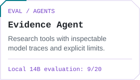</picture></a>
<a href="https://github.com/widechaos/deepseek-chat-navigator"><picture><source media="(prefers-color-scheme: dark) and (max-width:520px)" srcset="assets/typography/work-1-dark-mobile-124ae089eda7.svg" width="300"><source media="(prefers-color-scheme: dark)" srcset="assets/typography/work-1-dark-three-a0eb365ec7aa.svg"><source media="(max-width:520px)" srcset="assets/typography/work-1-light-mobile-1bb99e3c65d5.svg" width="300">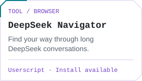</picture></a>
<a href="https://github.com/widechaos/Bulletin"><picture><source media="(prefers-color-scheme: dark) and (max-width:520px)" srcset="assets/typography/work-2-dark-mobile-fa5a3b462f72.svg" width="300"><source media="(prefers-color-scheme: dark)" srcset="assets/typography/work-2-dark-three-081f6dd81ab4.svg"><source media="(max-width:520px)" srcset="assets/typography/work-2-light-mobile-35f06ce017dc.svg" width="300">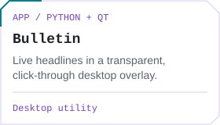</picture></a> 
<a href="https://github.com/widechaos/obsidian-cinematic-ui"><picture><source media="(prefers-color-scheme: dark) and (max-width:520px)" srcset="assets/typography/work-3-dark-mobile-2918f9930097.svg" width="300"><source media="(prefers-color-scheme: dark)" srcset="assets/typography/work-3-dark-three-954a297c6e32.svg"><source media="(max-width:520px)" srcset="assets/typography/work-3-light-mobile-bfb0d5781c33.svg" width="300">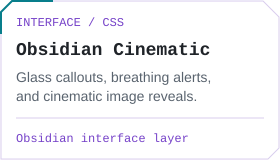</picture></a>
<a href="https://github.com/widechaos/Heartiger"><picture><source media="(prefers-color-scheme: dark) and (max-width:520px)" srcset="assets/typography/work-4-dark-mobile-151a2820e188.svg" width="300"><source media="(prefers-color-scheme: dark)" srcset="assets/typography/work-4-dark-three-92211448ada8.svg"><source media="(max-width:520px)" srcset="assets/typography/work-4-light-mobile-92351be9a05f.svg" width="300">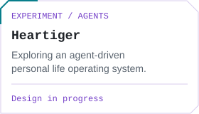</picture></a>
<a href="https://github.com/widechaos/widechaos-blog"><picture><source media="(prefers-color-scheme: dark) and (max-width:520px)" srcset="assets/typography/work-5-dark-mobile-cddde375af4e.svg" width="300"><source media="(prefers-color-scheme: dark)" srcset="assets/typography/work-5-dark-three-6146e7b638f0.svg"><source media="(max-width:520px)" srcset="assets/typography/work-5-light-mobile-6f00c27beb14.svg" width="300">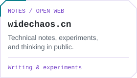</picture></a> 

Project notes &amp; evidence

- **[Evidence Agent](https://huggingface.co/spaces/WideChaos/evidence-agent)** — public research tools with inspectable model traces. Documented local 14B evaluation: **9/20**. [Code & setup](https://huggingface.co/spaces/WideChaos/evidence-agent/tree/main) · [Evidence & limits](https://huggingface.co/spaces/WideChaos/evidence-agent/blob/main/EVALUATION.md)
- **[deepseek-chat-navigator](https://github.com/widechaos/deepseek-chat-navigator)** — a browser userscript that turns long DeepSeek conversations into a question-and-answer outline with one-click navigation. [Install ↗](https://greasyfork.org/zh-CN/scripts/560039-deepseek-chat-navigator)
- **[Bulletin](https://github.com/widechaos/Bulletin)** — a Python + Qt desktop news overlay: live headlines, a transparent window, and click-through interaction.
- **[obsidian-cinematic-ui](https://github.com/widechaos/obsidian-cinematic-ui)** — a cinematic CSS motion layer for Obsidian: glass callouts, breathing alerts, image reveals.
- **[Heartiger](https://github.com/widechaos/Heartiger)** — designing an agent-driven personal life OS: lightweight journaling, intelligent organization, and a growing second brain.
- **[widechaos-blog](https://github.com/widechaos/widechaos-blog)** — thinking out loud, in the open → [widechaos.cn](https://widechaos.cn).

<h2><picture><source media="(prefers-color-scheme: dark) and (max-width:520px)" srcset="assets/typography/section-5-dark-mobile-b9073e962d0b.svg"><source media="(prefers-color-scheme: dark)" srcset="assets/typography/section-5-dark-wide-5944cfc66457.svg"><source media="(max-width:520px)" srcset="assets/typography/section-5-mobile-3697bf5fe66c.svg"></picture></h2>

<b>AI &amp; Agents</b> &nbsp;LangGraph · &nbsp;LangChain · &nbsp;Hugging&nbsp;Face · &nbsp;Transformers · &nbsp;Ollama · &nbsp;RAG · &nbsp;MCP

<b>Machine Learning &amp; Data</b> &nbsp;PyTorch · &nbsp;TensorFlow · &nbsp;scikit-learn · &nbsp;Pandas · &nbsp;NumPy · &nbsp;Matplotlib

<b>Voice &amp; Realtime</b> &nbsp;LiveKit · &nbsp;FunASR · &nbsp;faster-whisper · &nbsp;Azure&nbsp;Speech · &nbsp;WebRTC · &nbsp;SIP&nbsp;/&nbsp;FreeSWITCH

<b>Backend</b> &nbsp;Python · &nbsp;Django · &nbsp;FastAPI · &nbsp;Flask · &nbsp;Go · &nbsp;Pydantic

<b>Databases &amp; Retrieval</b> &nbsp;PostgreSQL · &nbsp;MySQL · &nbsp;SQLite · &nbsp;Redis · &nbsp;SQLAlchemy · &nbsp;Vector&nbsp;Search

<b>Web Crawling &amp; Automation</b> &nbsp;Scrapy · &nbsp;Beautiful&nbsp;Soup · &nbsp;Playwright · &nbsp;Selenium

<b>Cloud &amp; Storage</b> &nbsp;Docker · &nbsp;Kubernetes · &nbsp;Linux · &nbsp;Nginx · &nbsp;OpenStack · &nbsp;Ceph · &nbsp;Bash

<b>Frontend</b> &nbsp;TypeScript · &nbsp;JavaScript · &nbsp;Vite · &nbsp;Astro · &nbsp;HTML5 · &nbsp;CSS

<b>Testing &amp; Delivery</b> &nbsp;pytest · &nbsp;Git · &nbsp;GitHub&nbsp;Actions

<picture><source media="(prefers-reduced-motion: reduce) and (prefers-color-scheme: dark)" srcset="assets/motion/recon-drone-dark-still.svg"><source media="(prefers-reduced-motion: reduce)" srcset="assets/motion/recon-drone-light-still.svg"><source media="(prefers-color-scheme: dark)" srcset="assets/motion/recon-drone-dark.svg"></picture>

<h2><picture><source media="(prefers-color-scheme: dark) and (max-width:520px)" srcset="assets/typography/section-6-dark-mobile-982a9a6f5f0f.svg"><source media="(prefers-color-scheme: dark)" srcset="assets/typography/section-6-dark-wide-7382c6138b93.svg"><source media="(max-width:520px)" srcset="assets/typography/section-6-mobile-8f00b937e2ff.svg"></picture></h2>

<a href="https://widechaos.cn"><picture><source media="(prefers-color-scheme: dark) and (max-width:520px)" srcset="assets/typography/contact-0-dark-cdbd01fed46f.svg" width="250"><source media="(max-width:520px)" srcset="assets/typography/contact-0-light-e7f7c562dd8c.svg" width="250"><source media="(prefers-color-scheme: dark)" srcset="assets/typography/contact-0-dark-grid-843a971f6a35.svg"></picture></a>
<a href="mailto:ai@widechaos.cn"><picture><source media="(prefers-color-scheme: dark) and (max-width:520px)" srcset="assets/typography/contact-1-dark-cc7341d89be1.svg" width="250"><source media="(max-width:520px)" srcset="assets/typography/contact-1-light-1f42f354c49b.svg" width="250"><source media="(prefers-color-scheme: dark)" srcset="assets/typography/contact-1-dark-grid-5487317037d2.svg"></picture></a>
<a href="https://huggingface.co/WideChaos"><picture><source media="(prefers-color-scheme: dark) and (max-width:520px)" srcset="assets/typography/contact-2-dark-mobile-a690b9cf558c.svg" width="136" height="48"><source media="(max-width:520px)" srcset="assets/typography/contact-2-light-mobile-e46b7d068b5b.svg" width="136" height="48"><source media="(prefers-color-scheme: dark)" srcset="assets/typography/contact-2-dark-grid-a4e855f357e7.svg"></picture></a>
<a href="https://www.kaggle.com/xover2022"><picture><source media="(prefers-color-scheme: dark) and (max-width:520px)" srcset="assets/typography/contact-3-dark-mobile-cd4245d28163.svg" width="136" height="48"><source media="(max-width:520px)" srcset="assets/typography/contact-3-light-mobile-4f2931ed0308.svg" width="136" height="48"><source media="(prefers-color-scheme: dark)" srcset="assets/typography/contact-3-dark-grid-8b70df96b366.svg"></picture></a> 
<a href="https://www.linkedin.com/in/renchao-wu-widechaos/"><picture><source media="(prefers-color-scheme: dark) and (max-width:520px)" srcset="assets/typography/contact-4-dark-mobile-df58c00a6cb0.svg" width="136" height="48"><source media="(max-width:520px)" srcset="assets/typography/contact-4-light-mobile-dbebc981a067.svg" width="136" height="48"><source media="(prefers-color-scheme: dark)" srcset="assets/typography/contact-4-dark-grid-70ac38faee0f.svg"></picture></a>
<a href="https://x.com/thewidechaos"><picture><source media="(prefers-color-scheme: dark) and (max-width:520px)" srcset="assets/typography/contact-5-dark-mobile-7c9bbace1754.svg" width="136" height="48"><source media="(max-width:520px)" srcset="assets/typography/contact-5-light-mobile-514eb102ac12.svg" width="136" height="48"><source media="(prefers-color-scheme: dark)" srcset="assets/typography/contact-5-dark-grid-4047e4675430.svg"></picture></a>
<a href="https://dev.to/widechaos"><picture><source media="(prefers-color-scheme: dark) and (max-width:520px)" srcset="assets/typography/contact-6-dark-mobile-b1a3396909a0.svg" width="136" height="48"><source media="(max-width:520px)" srcset="assets/typography/contact-6-light-mobile-62b3e32d7aeb.svg" width="136" height="48"><source media="(prefers-color-scheme: dark)" srcset="assets/typography/contact-6-dark-grid-55dad351ecf9.svg"></picture></a>
<a href="https://bsky.app/profile/widechaos.bsky.social"><picture><source media="(prefers-color-scheme: dark) and (max-width:520px)" srcset="assets/typography/contact-7-dark-mobile-f5a4e1d0e04d.svg" width="136" height="48"><source media="(max-width:520px)" srcset="assets/typography/contact-7-light-mobile-81ef8ea0dd4d.svg" width="136" height="48"><source media="(prefers-color-scheme: dark)" srcset="assets/typography/contact-7-dark-grid-8a5f7dbfad03.svg"></picture></a> 

<h2><picture><source media="(prefers-color-scheme: dark) and (max-width:520px)" srcset="assets/typography/section-7-dark-mobile-51874c12091e.svg"><source media="(prefers-color-scheme: dark)" srcset="assets/typography/section-7-dark-wide-d588fe12592a.svg"><source media="(max-width:520px)" srcset="assets/typography/section-7-mobile-89c5059a6c0c.svg"></picture></h2>

<!-- OPEN-SOURCE-CONTRIBUTIONS:START -->

<a href="contributions/projects/genoffice.md"><picture><source media="(prefers-color-scheme: dark) and (max-width:520px)" srcset="assets/profile/contributions/genoffice-dark-0f0f07c0c978.svg" width="300" height="177"><source media="(max-width:520px)" srcset="assets/profile/contributions/genoffice-light-f4f30a6a701a.svg" width="300" height="177"><source media="(prefers-color-scheme: dark)" srcset="assets/profile/contributions/genoffice-dark-0f0f07c0c978.svg"></picture></a>
<a href="contributions/projects/logfire.md"><picture><source media="(prefers-color-scheme: dark) and (max-width:520px)" srcset="assets/profile/contributions/logfire-dark-67b45206dec8.svg" width="300" height="177"><source media="(max-width:520px)" srcset="assets/profile/contributions/logfire-light-20b2a55919e3.svg" width="300" height="177"><source media="(prefers-color-scheme: dark)" srcset="assets/profile/contributions/logfire-dark-67b45206dec8.svg"></picture></a>
<a href="contributions/projects/ekko-studio.md"><picture><source media="(prefers-color-scheme: dark) and (max-width:520px)" srcset="assets/profile/contributions/ekko-studio-dark-bd18df94605d.svg" width="300" height="177"><source media="(max-width:520px)" srcset="assets/profile/contributions/ekko-studio-light-6d57cdb4a1e4.svg" width="300" height="177"><source media="(prefers-color-scheme: dark)" srcset="assets/profile/contributions/ekko-studio-dark-bd18df94605d.svg"></picture></a>
<a href="contributions/projects/openwhispr.md"><picture><source media="(prefers-color-scheme: dark) and (max-width:520px)" srcset="assets/profile/contributions/openwhispr-dark-d009f36b0501.svg" width="300" height="177"><source media="(max-width:520px)" srcset="assets/profile/contributions/openwhispr-light-fbb995ff2684.svg" width="300" height="177"><source media="(prefers-color-scheme: dark)" srcset="assets/profile/contributions/openwhispr-dark-d009f36b0501.svg"></picture></a>
<a href="contributions/projects/mlx-audio.md"><picture><source media="(prefers-color-scheme: dark) and (max-width:520px)" srcset="assets/profile/contributions/mlx-audio-dark-adaa517da2a9.svg" width="300" height="177"><source media="(max-width:520px)" srcset="assets/profile/contributions/mlx-audio-light-4bcb6cc15813.svg" width="300" height="177"><source media="(prefers-color-scheme: dark)" srcset="assets/profile/contributions/mlx-audio-dark-adaa517da2a9.svg"></picture></a>
<a href="contributions/projects/ralph.md"><picture><source media="(prefers-color-scheme: dark) and (max-width:520px)" srcset="assets/profile/contributions/ralph-dark-90c7c648ce06.svg" width="300" height="177"><source media="(max-width:520px)" srcset="assets/profile/contributions/ralph-light-9622ae0e608d.svg" width="300" height="177"><source media="(prefers-color-scheme: dark)" srcset="assets/profile/contributions/ralph-dark-90c7c648ce06.svg"></picture></a>
<a href="contributions/projects/more-itertools.md"><picture><source media="(prefers-color-scheme: dark) and (max-width:520px)" srcset="assets/profile/contributions/more-itertools-dark-b70c08aac130.svg" width="300" height="177"><source media="(max-width:520px)" srcset="assets/profile/contributions/more-itertools-light-4c779791700e.svg" width="300" height="177"><source media="(prefers-color-scheme: dark)" srcset="assets/profile/contributions/more-itertools-dark-b70c08aac130.svg"></picture></a>
<a href="contributions/projects/livekit-agents.md"><picture><source media="(prefers-color-scheme: dark) and (max-width:520px)" srcset="assets/profile/contributions/livekit-agents-dark-7d713bd98cf3.svg" width="300" height="177"><source media="(max-width:520px)" srcset="assets/profile/contributions/livekit-agents-light-57840619aeb1.svg" width="300" height="177"><source media="(prefers-color-scheme: dark)" srcset="assets/profile/contributions/livekit-agents-dark-7d713bd98cf3.svg"></picture></a>
<a href="contributions/projects/tornado.md"><picture><source media="(prefers-color-scheme: dark) and (max-width:520px)" srcset="assets/profile/contributions/tornado-dark-bebd0a715e16.svg" width="300" height="177"><source media="(max-width:520px)" srcset="assets/profile/contributions/tornado-light-6445098013c2.svg" width="300" height="177"><source media="(prefers-color-scheme: dark)" srcset="assets/profile/contributions/tornado-dark-bebd0a715e16.svg"></picture></a>
<a href="contributions/projects/dateutil.md"><picture><source media="(prefers-color-scheme: dark) and (max-width:520px)" srcset="assets/profile/contributions/dateutil-dark-0d49bf7a1ff4.svg" width="300" height="177"><source media="(max-width:520px)" srcset="assets/profile/contributions/dateutil-light-24e339a27157.svg" width="300" height="177"><source media="(prefers-color-scheme: dark)" srcset="assets/profile/contributions/dateutil-dark-0d49bf7a1ff4.svg"></picture></a>
<a href="contributions/projects/python-dotenv.md"><picture><source media="(prefers-color-scheme: dark) and (max-width:520px)" srcset="assets/profile/contributions/python-dotenv-dark-f46efd0b6364.svg" width="300" height="177"><source media="(max-width:520px)" srcset="assets/profile/contributions/python-dotenv-light-8d7012d392f7.svg" width="300" height="177"><source media="(prefers-color-scheme: dark)" srcset="assets/profile/contributions/python-dotenv-dark-f46efd0b6364.svg"></picture></a>
<a href="contributions/projects/httpx.md"><picture><source media="(prefers-color-scheme: dark) and (max-width:520px)" srcset="assets/profile/contributions/httpx-dark-c6b444b4e4b3.svg" width="300" height="177"><source media="(max-width:520px)" srcset="assets/profile/contributions/httpx-light-248a35eaac77.svg" width="300" height="177"><source media="(prefers-color-scheme: dark)" srcset="assets/profile/contributions/httpx-dark-c6b444b4e4b3.svg"></picture></a>
<a href="contributions/projects/peonping.md"><picture><source media="(prefers-color-scheme: dark) and (max-width:520px)" srcset="assets/profile/contributions/peonping-dark-c6651123d41d.svg" width="300" height="177"><source media="(max-width:520px)" srcset="assets/profile/contributions/peonping-light-4091ed784064.svg" width="300" height="177"><source media="(prefers-color-scheme: dark)" srcset="assets/profile/contributions/peonping-dark-c6651123d41d.svg"></picture></a>
<a href="contributions/projects/faster-whisper.md"><picture><source media="(prefers-color-scheme: dark) and (max-width:520px)" srcset="assets/profile/contributions/faster-whisper-dark-c9fc6e167bc8.svg" width="300" height="177"><source media="(max-width:520px)" srcset="assets/profile/contributions/faster-whisper-light-725de5c622f5.svg" width="300" height="177"><source media="(prefers-color-scheme: dark)" srcset="assets/profile/contributions/faster-whisper-dark-c9fc6e167bc8.svg"></picture></a>

[Contribution details →](contributions/README.md)

<!-- OPEN-SOURCE-CONTRIBUTIONS:END -->

<i>Per aspera ad astra.</i>

<picture><source media="(prefers-reduced-motion: reduce) and (prefers-color-scheme: dark)" srcset="assets/motion/pixel-coder-dark-still.png"><source media="(prefers-reduced-motion: reduce)" srcset="assets/motion/pixel-coder-light-still.png"><source media="(prefers-color-scheme: dark)" srcset="assets/motion/pixel-coder-dark.gif"></picture> STILL BUILDING // WIDECHAOS

