RENCHAO WU / WIDECHAOS

<picture><source media="(prefers-reduced-motion: reduce) and (prefers-color-scheme: dark) and (max-width:520px)" srcset="assets/motion/header-dark-mobile-still.svg"><source media="(prefers-reduced-motion: reduce) and (max-width:520px)" srcset="assets/motion/header-light-mobile-still.svg"><source media="(prefers-reduced-motion: reduce) and (prefers-color-scheme: dark)" srcset="assets/motion/header-dark-wide-still.svg"><source media="(prefers-reduced-motion: reduce)" srcset="assets/motion/header-light-wide-still.svg"><source media="(prefers-color-scheme: dark) and (max-width:520px)" srcset="assets/motion/header-dark-mobile.svg"><source media="(prefers-color-scheme: dark)" srcset="assets/motion/header-dark-wide.svg"><source media="(max-width:520px)" srcset="assets/motion/header-light-mobile.svg"></picture>

  <b>智灯已灭余空烬，犹自光明照十方</b> 
  <i>"From the ashes a fire shall be woken, a light from the shadows shall spring." — J.R.R. Tolkien</i>

<h2><picture><source media="(prefers-color-scheme: dark) and (max-width:520px)" srcset="assets/section-1-dark-mobile.svg"><source media="(prefers-color-scheme: dark)" srcset="assets/section-1-dark-wide.svg"><source media="(max-width:520px)" srcset="assets/section-1-mobile.svg"></picture></h2>

<picture><source media="(prefers-reduced-motion: reduce) and (prefers-color-scheme: dark) and (max-width:520px)" srcset="assets/motion/identity-panel-dark-mobile-still.svg"><source media="(prefers-reduced-motion: reduce) and (max-width:520px)" srcset="assets/motion/identity-panel-light-mobile-still.svg"><source media="(prefers-reduced-motion: reduce) and (prefers-color-scheme: dark)" srcset="assets/motion/identity-panel-dark-wide-still.svg"><source media="(prefers-reduced-motion: reduce)" srcset="assets/motion/identity-panel-light-wide-still.svg"><source media="(prefers-color-scheme: dark) and (max-width:520px)" srcset="assets/motion/identity-panel-dark-mobile.svg"><source media="(prefers-color-scheme: dark)" srcset="assets/motion/identity-panel-dark-wide.svg"><source media="(max-width:520px)" srcset="assets/motion/identity-panel-light-mobile.svg"></picture>

NOW / Voice agents & realtime systems

<b>./manifesto</b>

<picture><source media="(prefers-color-scheme: dark) and (max-width:520px)" srcset="assets/manifesto-dark-mobile.svg"><source media="(prefers-color-scheme: dark)" srcset="assets/manifesto-dark.svg"><source media="(max-width:520px)" srcset="assets/manifesto-light-mobile.svg"></picture>

<h2><picture><source media="(prefers-color-scheme: dark) and (max-width:520px)" srcset="assets/section-2-dark-mobile.svg"><source media="(prefers-color-scheme: dark)" srcset="assets/section-2-dark-wide.svg"><source media="(max-width:520px)" srcset="assets/section-2-mobile.svg"></picture></h2>

Repository languages

<h2><picture><source media="(prefers-color-scheme: dark) and (max-width:520px)" srcset="assets/section-3-dark-mobile.svg"><source media="(prefers-color-scheme: dark)" srcset="assets/section-3-dark-wide.svg"><source media="(max-width:520px)" srcset="assets/section-3-mobile.svg"></picture></h2>

<!-- COMMUNITY-BADGES:START -->

<kbd><a href="assets/certificates/databricks-generative-ai.png">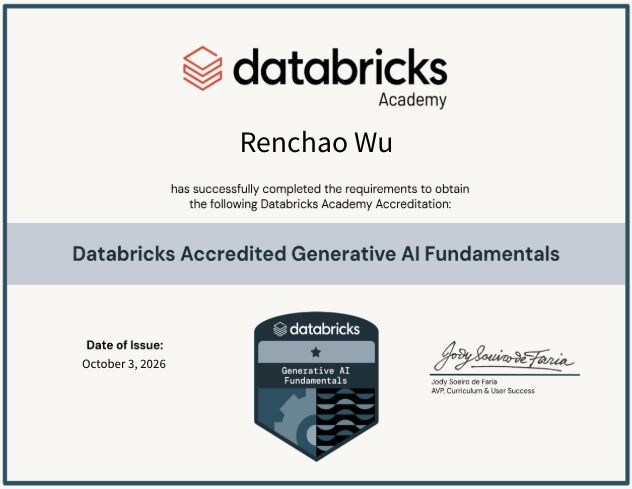</a></kbd> <kbd><a href="assets/certificates/databricks-ai-agent.png">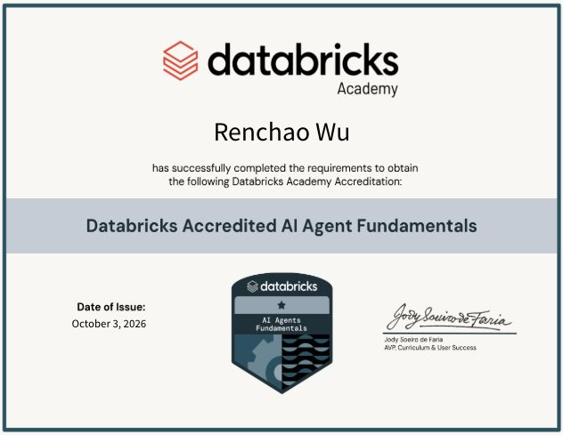</a></kbd> <kbd></kbd> <kbd></kbd> <kbd></kbd> <kbd><a href="assets/certificates/alibaba-cloud-generative-ai.png">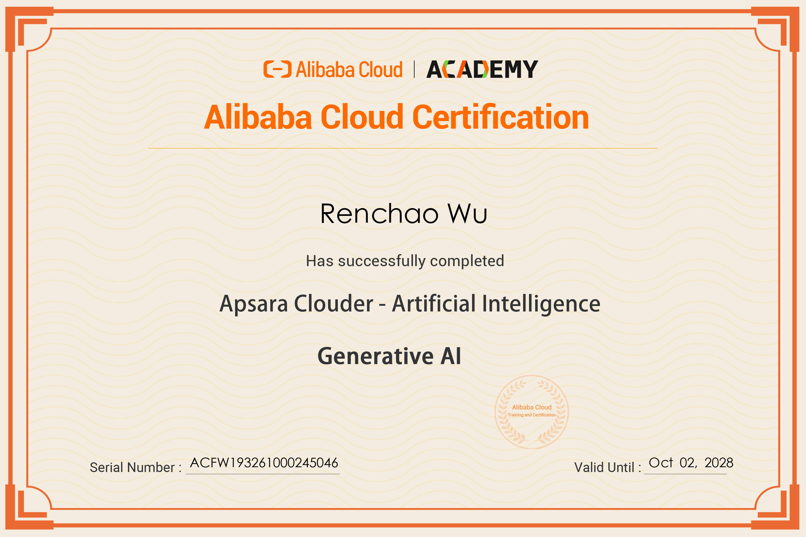</a></kbd> <kbd><a href="assets/certificates/cognitive-class-prompt-engineering.png">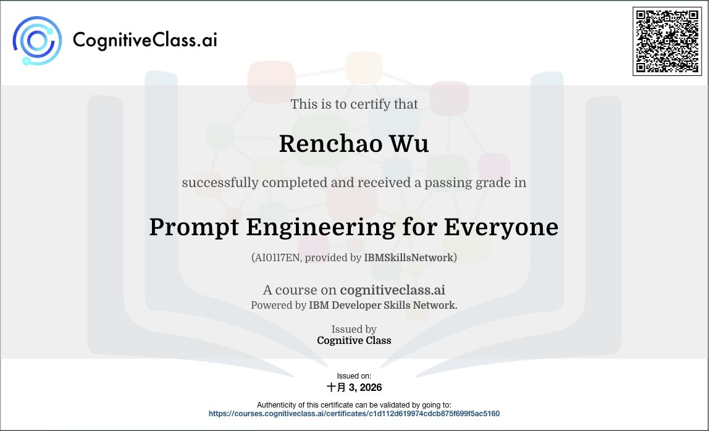</a></kbd> <kbd><a href="assets/certificates/cognitive-class-chatbot.png">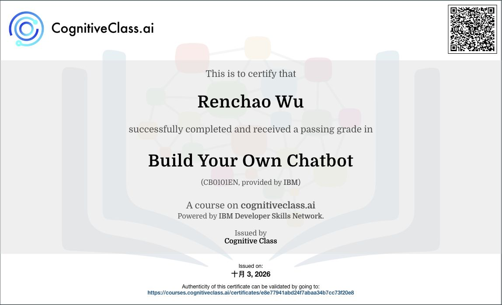</a></kbd> <kbd><a href="assets/certificates/cognitive-class-fundamentals-ai.png">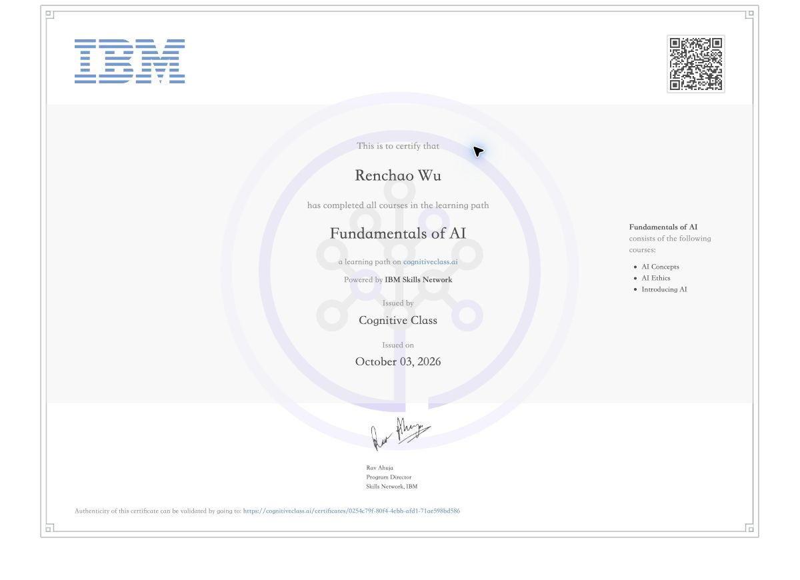</a></kbd> <kbd><a href="assets/certificates/cognitive-class-machine-learning.png">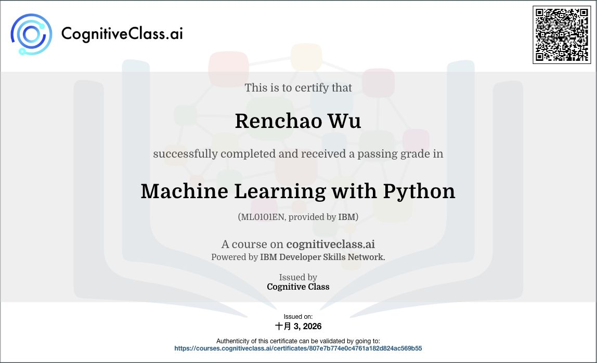</a></kbd> <kbd><a href="assets/certificates/ibm-skillsbuild-ai-fundamentals.png">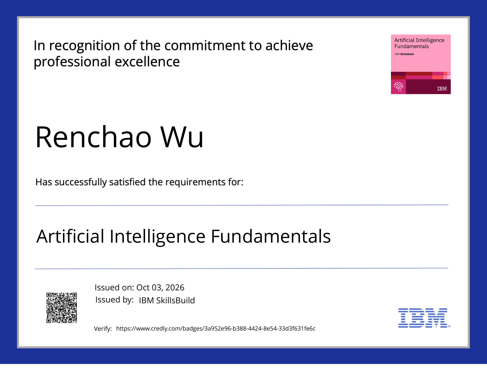</a></kbd>

Verify learning credentials

AI learning · <a href="https://credentials.databricks.com/df0c7dc3-88d9-4de0-99d4-781e917aae76">Generative AI Fundamentals</a> · <a href="https://credentials.databricks.com/d56e8b1d-3c06-43cb-8b4f-6f4d6778a9fc">AI Agent Fundamentals</a> · <a href="https://credentials.databricks.com/7c66e79f-43fd-4b94-8f2a-12a2c8f16739">AI Security Fundamentals</a> · <a href="https://huggingface.co/datasets/agents-course/certificates/resolve/main/certificates/WideChaos/2026-10-03.png">Hugging Face Agents · Unit 1</a> · <a href="https://huggingface.co/datasets/agents-course/final-certificates/resolve/main/certificates/WideChaos/2026-10-03.png">Hugging Face Agents · Full course</a> · <a href="assets/certificates/alibaba-cloud-generative-ai.png">Alibaba Cloud · Generative AI</a> · <a href="https://courses.cognitiveclass.ai/certificates/c1d112d619974cdcb875f699f5ac5160">IBM Skills Network · Prompt Engineering</a> · <a href="https://courses.cognitiveclass.ai/certificates/e8e77941abd24f7abaa34b7cc73f20e8">IBM · Build Your Own Chatbot</a> · <a href="https://cognitiveclass.ai/certificates/0254c79f-80f4-4ebb-afd1-71ae598bd586">IBM Skills Network · Fundamentals of AI</a> · <a href="https://courses.cognitiveclass.ai/certificates/807e7b774e0c4761a182d824ac569b55">IBM · Machine Learning with Python</a> · <a href="https://www.credly.com/badges/3a952e96-b388-4424-8e54-33d3f631fe6c/public_url">IBM SkillsBuild · Artificial Intelligence Fundamentals</a>

<kbd></kbd> <kbd></kbd> <kbd></kbd> <kbd></kbd> <kbd></kbd> <kbd></kbd> <kbd></kbd> <kbd></kbd> <kbd></kbd> <kbd></kbd> <kbd></kbd> <kbd></kbd> <kbd></kbd> <kbd></kbd>
 
Kaggle · DEV

<kbd><a href="https://weread.qq.com/">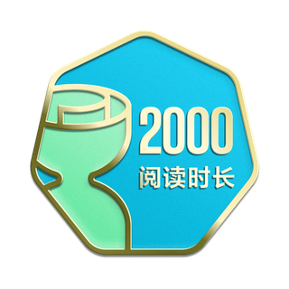</a></kbd> <kbd></kbd> <kbd></kbd> <kbd></kbd> <kbd><a href="https://weread.qq.com/">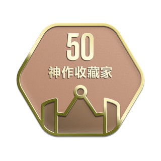</a></kbd> <kbd><a href="https://weread.qq.com/">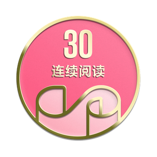</a></kbd> <kbd></kbd> <kbd><a href="https://weread.qq.com/">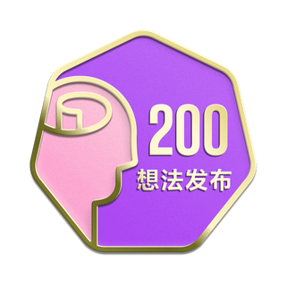</a></kbd> <kbd><a href="https://weread.qq.com/">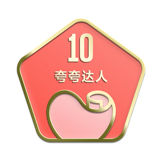</a></kbd> <kbd><a href="https://weread.qq.com/">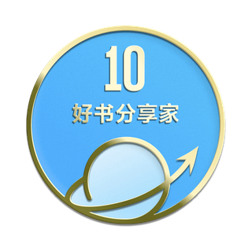</a></kbd> <kbd><a href="https://weread.qq.com/">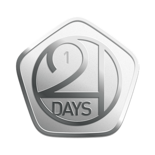</a></kbd> <kbd></kbd> <kbd><a href="https://weread.qq.com/">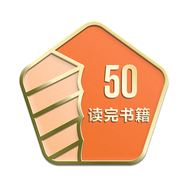</a></kbd> <kbd><a href="https://weread.qq.com/">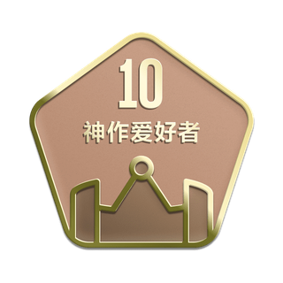</a></kbd> 
WeRead · Reading milestones

More reading badges

<kbd><a href="https://weread.qq.com/">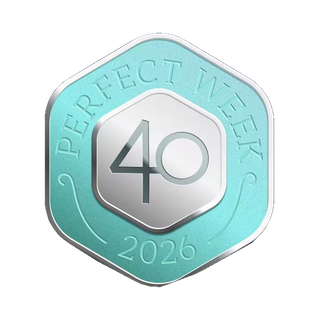</a></kbd> <kbd><a href="https://weread.qq.com/">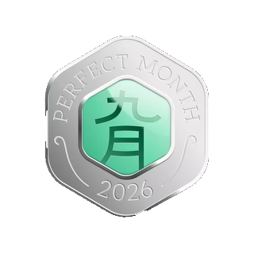</a></kbd> <kbd><a href="https://weread.qq.com/">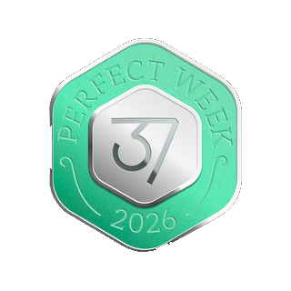</a></kbd> <kbd><a href="https://weread.qq.com/">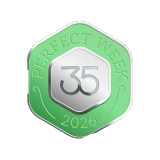</a></kbd> <kbd><a href="https://weread.qq.com/">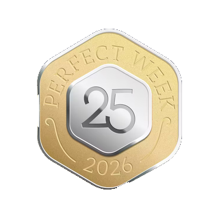</a></kbd> <kbd><a href="https://weread.qq.com/">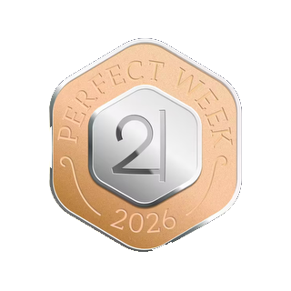</a></kbd> <kbd><a href="https://weread.qq.com/">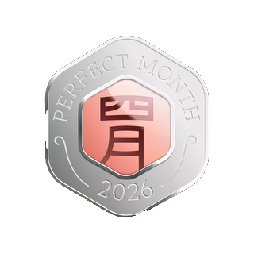</a></kbd> <kbd><a href="https://weread.qq.com/">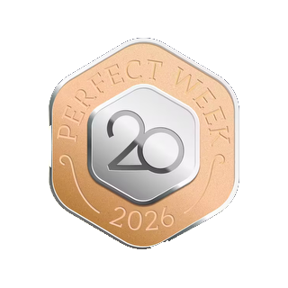</a></kbd> <kbd><a href="https://weread.qq.com/">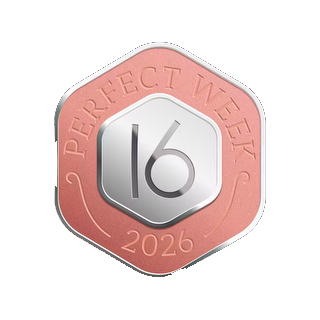</a></kbd> <kbd></kbd> <kbd><a href="https://weread.qq.com/">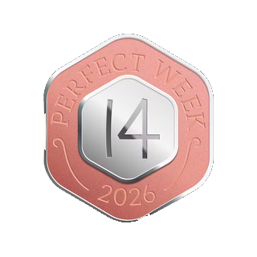</a></kbd> <kbd></kbd> <kbd><a href="https://weread.qq.com/">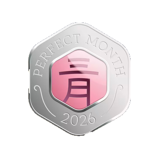</a></kbd> <kbd><a href="https://weread.qq.com/">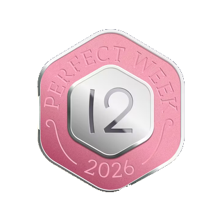</a></kbd> <kbd><a href="https://weread.qq.com/">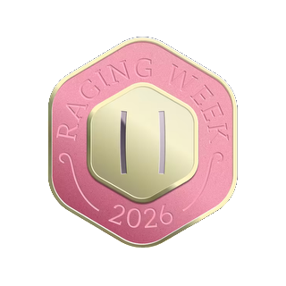</a></kbd> <kbd><a href="https://weread.qq.com/">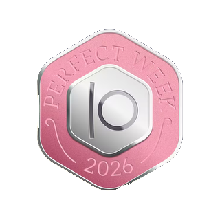</a></kbd> <kbd><a href="https://weread.qq.com/">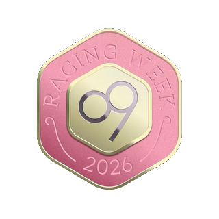</a></kbd> <kbd><a href="https://weread.qq.com/">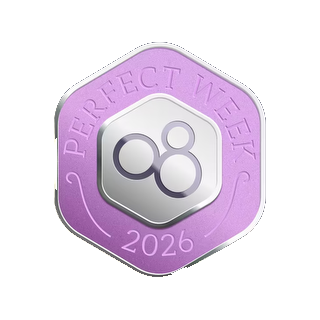</a></kbd> <kbd><a href="https://weread.qq.com/">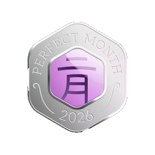</a></kbd> <kbd></kbd> <kbd><a href="https://weread.qq.com/">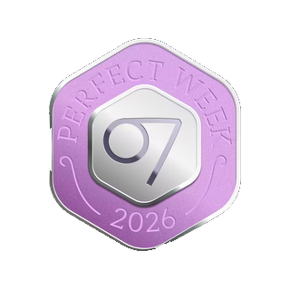</a></kbd> <kbd></kbd> <kbd><a href="https://weread.qq.com/">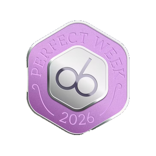</a></kbd> <kbd><a href="https://weread.qq.com/">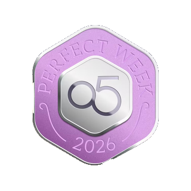</a></kbd> <kbd></kbd> <kbd><a href="https://weread.qq.com/">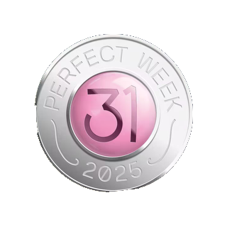</a></kbd> <kbd><a href="https://weread.qq.com/">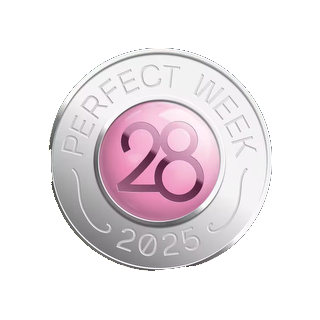</a></kbd> <kbd><a href="https://weread.qq.com/">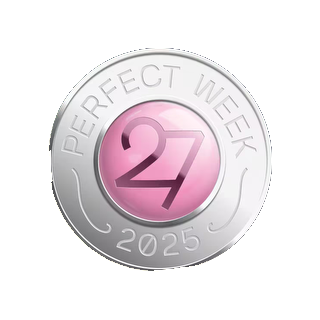</a></kbd> <kbd><a href="https://weread.qq.com/">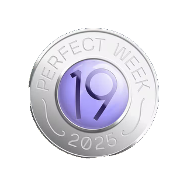</a></kbd> <kbd><a href="https://weread.qq.com/">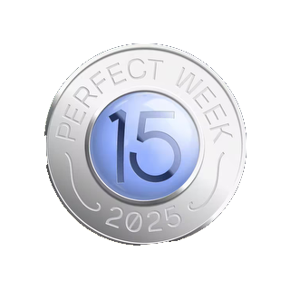</a></kbd> <kbd><a href="https://weread.qq.com/">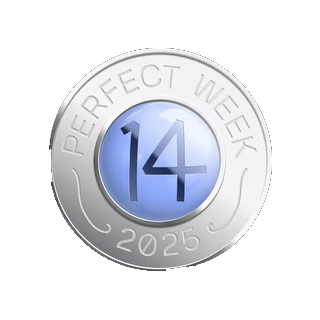</a></kbd> <kbd><a href="https://weread.qq.com/">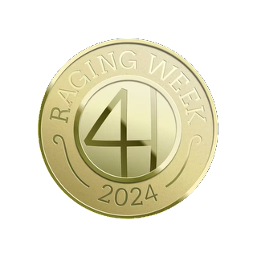</a></kbd> <kbd></kbd> <kbd></kbd> <kbd><a href="https://weread.qq.com/">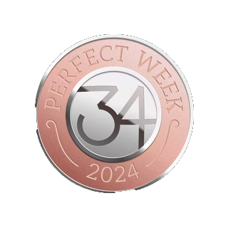</a></kbd> <kbd><a href="https://weread.qq.com/">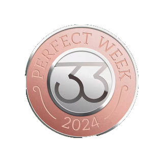</a></kbd> <kbd><a href="https://weread.qq.com/">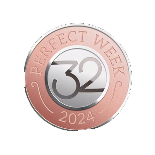</a></kbd> <kbd><a href="https://weread.qq.com/">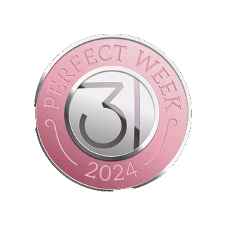</a></kbd> <kbd><a href="https://weread.qq.com/">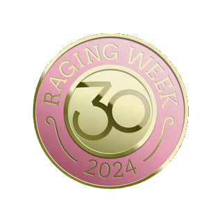</a></kbd> <kbd></kbd> <kbd></kbd> <kbd></kbd> <kbd></kbd> <kbd></kbd> <kbd></kbd> <kbd></kbd> <kbd></kbd> <kbd></kbd> <kbd></kbd> <kbd></kbd> <kbd></kbd> <kbd></kbd> <kbd></kbd> <kbd></kbd> <kbd></kbd> <kbd></kbd> <kbd></kbd> <kbd></kbd> <kbd></kbd> <kbd></kbd> <kbd></kbd> <kbd></kbd> <kbd></kbd> <kbd></kbd> <kbd></kbd> <kbd></kbd> <kbd></kbd> <kbd></kbd> <kbd></kbd> <kbd></kbd> <kbd></kbd> <kbd></kbd> <kbd></kbd> <kbd></kbd> <kbd></kbd> <kbd></kbd> <kbd></kbd> <kbd></kbd> <kbd></kbd> <kbd></kbd> <kbd></kbd> <kbd></kbd> <kbd></kbd> <kbd></kbd> <kbd></kbd> <kbd></kbd> <kbd></kbd> <kbd></kbd> <kbd></kbd> <kbd></kbd> <kbd></kbd> <kbd></kbd> <kbd></kbd> <kbd></kbd> <kbd></kbd>

<!-- COMMUNITY-BADGES:END -->

<h2><picture><source media="(prefers-color-scheme: dark) and (max-width:520px)" srcset="assets/section-4-dark-mobile.svg"><source media="(prefers-color-scheme: dark)" srcset="assets/section-4-dark-wide.svg"><source media="(max-width:520px)" srcset="assets/section-4-mobile.svg"></picture></h2>

<a href="https://huggingface.co/spaces/WideChaos/evidence-agent"><picture><source media="(prefers-color-scheme: dark) and (max-width:520px)" srcset="assets/work-0-dark-mobile.svg" width="300"><source media="(prefers-color-scheme: dark)" srcset="assets/work-0-dark-three.svg"><source media="(max-width:520px)" srcset="assets/work-0-light-mobile.svg" width="300"></picture></a>
<a href="https://github.com/widechaos/deepseek-chat-navigator"><picture><source media="(prefers-color-scheme: dark) and (max-width:520px)" srcset="assets/work-1-dark-mobile.svg" width="300"><source media="(prefers-color-scheme: dark)" srcset="assets/work-1-dark-three.svg"><source media="(max-width:520px)" srcset="assets/work-1-light-mobile.svg" width="300"></picture></a>
<a href="https://github.com/widechaos/Bulletin"><picture><source media="(prefers-color-scheme: dark) and (max-width:520px)" srcset="assets/work-2-dark-mobile.svg" width="300"><source media="(prefers-color-scheme: dark)" srcset="assets/work-2-dark-three.svg"><source media="(max-width:520px)" srcset="assets/work-2-light-mobile.svg" width="300"></picture></a> 
<a href="https://github.com/widechaos/obsidian-cinematic-ui"><picture><source media="(prefers-color-scheme: dark) and (max-width:520px)" srcset="assets/work-3-dark-mobile.svg" width="300"><source media="(prefers-color-scheme: dark)" srcset="assets/work-3-dark-three.svg"><source media="(max-width:520px)" srcset="assets/work-3-light-mobile.svg" width="300"></picture></a>
<a href="https://github.com/widechaos/Heartiger"><picture><source media="(prefers-color-scheme: dark) and (max-width:520px)" srcset="assets/work-4-dark-mobile.svg" width="300"><source media="(prefers-color-scheme: dark)" srcset="assets/work-4-dark-three.svg"><source media="(max-width:520px)" srcset="assets/work-4-light-mobile.svg" width="300"></picture></a>
<a href="https://github.com/widechaos/widechaos-blog"><picture><source media="(prefers-color-scheme: dark) and (max-width:520px)" srcset="assets/work-5-dark-mobile.svg" width="300"><source media="(prefers-color-scheme: dark)" srcset="assets/work-5-dark-three.svg"><source media="(max-width:520px)" srcset="assets/work-5-light-mobile.svg" width="300"></picture></a> 

Project notes &amp; evidence

- **[Evidence Agent](https://huggingface.co/spaces/WideChaos/evidence-agent)** — public research tools with inspectable model traces. Documented local 14B evaluation: **9/20**. [Code & setup](https://huggingface.co/spaces/WideChaos/evidence-agent/tree/main) · [Evidence & limits](https://huggingface.co/spaces/WideChaos/evidence-agent/blob/main/EVALUATION.md)
- **[deepseek-chat-navigator](https://github.com/widechaos/deepseek-chat-navigator)** — a browser userscript that turns long DeepSeek conversations into a question-and-answer outline with one-click navigation. [Install ↗](https://greasyfork.org/zh-CN/scripts/560039-deepseek-chat-navigator)
- **[Bulletin](https://github.com/widechaos/Bulletin)** — a Python + Qt desktop news overlay: live headlines, a transparent window, and click-through interaction.
- **[obsidian-cinematic-ui](https://github.com/widechaos/obsidian-cinematic-ui)** — a cinematic CSS motion layer for Obsidian: glass callouts, breathing alerts, image reveals.
- **[Heartiger](https://github.com/widechaos/Heartiger)** — designing an agent-driven personal life OS: lightweight journaling, intelligent organization, and a growing second brain.
- **[widechaos-blog](https://github.com/widechaos/widechaos-blog)** — thinking out loud, in the open → [widechaos.cn](https://widechaos.cn).

<h2><picture><source media="(prefers-color-scheme: dark) and (max-width:520px)" srcset="assets/section-5-dark-mobile.svg"><source media="(prefers-color-scheme: dark)" srcset="assets/section-5-dark-wide.svg"><source media="(max-width:520px)" srcset="assets/section-5-mobile.svg"></picture></h2>

<b>AI &amp; Agents</b> &nbsp;LangGraph · &nbsp;LangChain · &nbsp;Hugging&nbsp;Face · &nbsp;Transformers · &nbsp;Ollama · &nbsp;RAG · &nbsp;MCP

<b>Machine Learning &amp; Data</b> &nbsp;PyTorch · &nbsp;TensorFlow · &nbsp;scikit-learn · &nbsp;Pandas · &nbsp;NumPy · &nbsp;Matplotlib

<b>Voice &amp; Realtime</b> &nbsp;LiveKit · &nbsp;FunASR · &nbsp;faster-whisper · &nbsp;Azure&nbsp;Speech · &nbsp;WebRTC · &nbsp;SIP&nbsp;/&nbsp;FreeSWITCH

<b>Backend</b> &nbsp;Python · &nbsp;Django · &nbsp;FastAPI · &nbsp;Flask · &nbsp;Go · &nbsp;Pydantic

<b>Databases &amp; Retrieval</b> &nbsp;PostgreSQL · &nbsp;MySQL · &nbsp;SQLite · &nbsp;Redis · &nbsp;SQLAlchemy · &nbsp;Vector&nbsp;Search

<b>Web Crawling &amp; Automation</b> &nbsp;Scrapy · &nbsp;Beautiful&nbsp;Soup · &nbsp;Playwright · &nbsp;Selenium

<b>Cloud &amp; Storage</b> &nbsp;Docker · &nbsp;Kubernetes · &nbsp;Linux · &nbsp;Nginx · &nbsp;OpenStack · &nbsp;Ceph · &nbsp;Bash

<b>Frontend</b> &nbsp;TypeScript · &nbsp;JavaScript · &nbsp;Vite · &nbsp;Astro · &nbsp;HTML5 · &nbsp;CSS

<b>Testing &amp; Delivery</b> &nbsp;pytest · &nbsp;Git · &nbsp;GitHub&nbsp;Actions

<picture><source media="(prefers-reduced-motion: reduce) and (prefers-color-scheme: dark)" srcset="assets/motion/recon-drone-dark-still.svg"><source media="(prefers-reduced-motion: reduce)" srcset="assets/motion/recon-drone-light-still.svg"><source media="(prefers-color-scheme: dark)" srcset="assets/motion/recon-drone-dark.svg"></picture>

<h2><picture><source media="(prefers-color-scheme: dark) and (max-width:520px)" srcset="assets/section-6-dark-mobile.svg"><source media="(prefers-color-scheme: dark)" srcset="assets/section-6-dark-wide.svg"><source media="(max-width:520px)" srcset="assets/section-6-mobile.svg"></picture></h2>

<a href="https://widechaos.cn"><picture><source media="(prefers-color-scheme: dark) and (max-width:520px)" srcset="assets/contact-0-dark.svg" width="250"><source media="(max-width:520px)" srcset="assets/contact-0-light.svg" width="250"><source media="(prefers-color-scheme: dark)" srcset="assets/contact-0-dark-grid.svg"></picture></a>
<a href="mailto:ai@widechaos.cn"><picture><source media="(prefers-color-scheme: dark) and (max-width:520px)" srcset="assets/contact-1-dark.svg" width="250"><source media="(max-width:520px)" srcset="assets/contact-1-light.svg" width="250"><source media="(prefers-color-scheme: dark)" srcset="assets/contact-1-dark-grid.svg"></picture></a>
<a href="https://huggingface.co/WideChaos"><picture><source media="(prefers-color-scheme: dark) and (max-width:520px)" srcset="assets/contact-2-dark-mobile.svg" width="136" height="48"><source media="(max-width:520px)" srcset="assets/contact-2-light-mobile.svg" width="136" height="48"><source media="(prefers-color-scheme: dark)" srcset="assets/contact-2-dark-grid.svg"></picture></a>
<a href="https://www.kaggle.com/xover2022"><picture><source media="(prefers-color-scheme: dark) and (max-width:520px)" srcset="assets/contact-3-dark-mobile.svg" width="136" height="48"><source media="(max-width:520px)" srcset="assets/contact-3-light-mobile.svg" width="136" height="48"><source media="(prefers-color-scheme: dark)" srcset="assets/contact-3-dark-grid.svg"></picture></a> 
<a href="https://www.linkedin.com/in/renchao-wu-widechaos/"><picture><source media="(prefers-color-scheme: dark) and (max-width:520px)" srcset="assets/contact-4-dark-mobile.svg" width="136" height="48"><source media="(max-width:520px)" srcset="assets/contact-4-light-mobile.svg" width="136" height="48"><source media="(prefers-color-scheme: dark)" srcset="assets/contact-4-dark-grid.svg"></picture></a>
<a href="https://x.com/thewidechaos"><picture><source media="(prefers-color-scheme: dark) and (max-width:520px)" srcset="assets/contact-5-dark-mobile.svg" width="136" height="48"><source media="(max-width:520px)" srcset="assets/contact-5-light-mobile.svg" width="136" height="48"><source media="(prefers-color-scheme: dark)" srcset="assets/contact-5-dark-grid.svg"></picture></a>
<a href="https://dev.to/widechaos"><picture><source media="(prefers-color-scheme: dark) and (max-width:520px)" srcset="assets/contact-6-dark-mobile.svg" width="136" height="48"><source media="(max-width:520px)" srcset="assets/contact-6-light-mobile.svg" width="136" height="48"><source media="(prefers-color-scheme: dark)" srcset="assets/contact-6-dark-grid.svg"></picture></a>
<a href="https://bsky.app/profile/widechaos.bsky.social"><picture><source media="(prefers-color-scheme: dark) and (max-width:520px)" srcset="assets/contact-7-dark-mobile.svg" width="136" height="48"><source media="(max-width:520px)" srcset="assets/contact-7-light-mobile.svg" width="136" height="48"><source media="(prefers-color-scheme: dark)" srcset="assets/contact-7-dark-grid.svg"></picture></a> 

<h2><picture><source media="(prefers-color-scheme: dark) and (max-width:520px)" srcset="assets/section-7-dark-mobile.svg"><source media="(prefers-color-scheme: dark)" srcset="assets/section-7-dark-wide.svg"><source media="(max-width:520px)" srcset="assets/section-7-mobile.svg"></picture></h2>

<!-- OPEN-SOURCE-CONTRIBUTIONS:START -->

<a href="contributions/projects/ralph.md"><picture><source media="(prefers-color-scheme: dark) and (max-width:520px)" srcset="assets/profile/contributions/ralph-dark.svg" width="300" height="177"><source media="(max-width:520px)" srcset="assets/profile/contributions/ralph-light.svg" width="300" height="177"><source media="(prefers-color-scheme: dark)" srcset="assets/profile/contributions/ralph-dark.svg"></picture></a>
<a href="contributions/projects/mlx-audio.md"><picture><source media="(prefers-color-scheme: dark) and (max-width:520px)" srcset="assets/profile/contributions/mlx-audio-dark.svg" width="300" height="177"><source media="(max-width:520px)" srcset="assets/profile/contributions/mlx-audio-light.svg" width="300" height="177"><source media="(prefers-color-scheme: dark)" srcset="assets/profile/contributions/mlx-audio-dark.svg"></picture></a>
<a href="contributions/projects/more-itertools.md"><picture><source media="(prefers-color-scheme: dark) and (max-width:520px)" srcset="assets/profile/contributions/more-itertools-dark.svg" width="300" height="177"><source media="(max-width:520px)" srcset="assets/profile/contributions/more-itertools-light.svg" width="300" height="177"><source media="(prefers-color-scheme: dark)" srcset="assets/profile/contributions/more-itertools-dark.svg"></picture></a>
<a href="contributions/projects/ekko-studio.md"><picture><source media="(prefers-color-scheme: dark) and (max-width:520px)" srcset="assets/profile/contributions/ekko-studio-dark.svg" width="300" height="177"><source media="(max-width:520px)" srcset="assets/profile/contributions/ekko-studio-light.svg" width="300" height="177"><source media="(prefers-color-scheme: dark)" srcset="assets/profile/contributions/ekko-studio-dark.svg"></picture></a>
<a href="contributions/projects/logfire.md"><picture><source media="(prefers-color-scheme: dark) and (max-width:520px)" srcset="assets/profile/contributions/logfire-dark.svg" width="300" height="177"><source media="(max-width:520px)" srcset="assets/profile/contributions/logfire-light.svg" width="300" height="177"><source media="(prefers-color-scheme: dark)" srcset="assets/profile/contributions/logfire-dark.svg"></picture></a>
<a href="contributions/projects/livekit-agents.md"><picture><source media="(prefers-color-scheme: dark) and (max-width:520px)" srcset="assets/profile/contributions/livekit-agents-dark.svg" width="300" height="177"><source media="(max-width:520px)" srcset="assets/profile/contributions/livekit-agents-light.svg" width="300" height="177"><source media="(prefers-color-scheme: dark)" srcset="assets/profile/contributions/livekit-agents-dark.svg"></picture></a>
<a href="contributions/projects/tornado.md"><picture><source media="(prefers-color-scheme: dark) and (max-width:520px)" srcset="assets/profile/contributions/tornado-dark.svg" width="300" height="177"><source media="(max-width:520px)" srcset="assets/profile/contributions/tornado-light.svg" width="300" height="177"><source media="(prefers-color-scheme: dark)" srcset="assets/profile/contributions/tornado-dark.svg"></picture></a>
<a href="contributions/projects/httpx.md"><picture><source media="(prefers-color-scheme: dark) and (max-width:520px)" srcset="assets/profile/contributions/httpx-dark.svg" width="300" height="177"><source media="(max-width:520px)" srcset="assets/profile/contributions/httpx-light.svg" width="300" height="177"><source media="(prefers-color-scheme: dark)" srcset="assets/profile/contributions/httpx-dark.svg"></picture></a>
<a href="contributions/projects/python-dotenv.md"><picture><source media="(prefers-color-scheme: dark) and (max-width:520px)" srcset="assets/profile/contributions/python-dotenv-dark.svg" width="300" height="177"><source media="(max-width:520px)" srcset="assets/profile/contributions/python-dotenv-light.svg" width="300" height="177"><source media="(prefers-color-scheme: dark)" srcset="assets/profile/contributions/python-dotenv-dark.svg"></picture></a>
<a href="contributions/projects/dateutil.md"><picture><source media="(prefers-color-scheme: dark) and (max-width:520px)" srcset="assets/profile/contributions/dateutil-dark.svg" width="300" height="177"><source media="(max-width:520px)" srcset="assets/profile/contributions/dateutil-light.svg" width="300" height="177"><source media="(prefers-color-scheme: dark)" srcset="assets/profile/contributions/dateutil-dark.svg"></picture></a>
<a href="contributions/projects/peonping.md"><picture><source media="(prefers-color-scheme: dark) and (max-width:520px)" srcset="assets/profile/contributions/peonping-dark.svg" width="300" height="177"><source media="(max-width:520px)" srcset="assets/profile/contributions/peonping-light.svg" width="300" height="177"><source media="(prefers-color-scheme: dark)" srcset="assets/profile/contributions/peonping-dark.svg"></picture></a>
<a href="contributions/projects/faster-whisper.md"><picture><source media="(prefers-color-scheme: dark) and (max-width:520px)" srcset="assets/profile/contributions/faster-whisper-dark.svg" width="300" height="177"><source media="(max-width:520px)" srcset="assets/profile/contributions/faster-whisper-light.svg" width="300" height="177"><source media="(prefers-color-scheme: dark)" srcset="assets/profile/contributions/faster-whisper-dark.svg"></picture></a>

[Contribution details →](contributions/README.md)

<!-- OPEN-SOURCE-CONTRIBUTIONS:END -->

<i>Per aspera ad astra.</i>

<picture><source media="(prefers-reduced-motion: reduce) and (prefers-color-scheme: dark)" srcset="assets/motion/pixel-coder-dark-still.png"><source media="(prefers-reduced-motion: reduce)" srcset="assets/motion/pixel-coder-light-still.png"><source media="(prefers-color-scheme: dark)" srcset="assets/motion/pixel-coder-dark.gif"></picture> STILL BUILDING // WIDECHAOS

